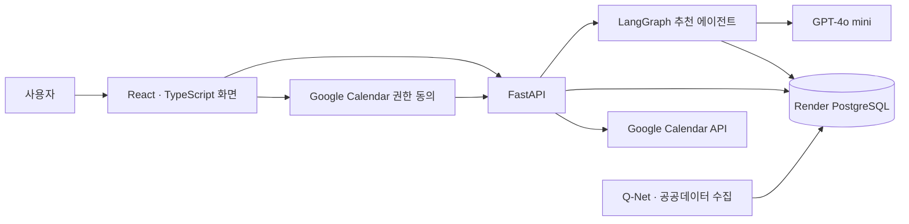

<h1 align="center">자격잇다</h1>

<p align="center"><strong>자격증 탐색부터 시험 일정 관리까지, 준비 과정을 이어주는 서비스</strong></p>

<p align="center">관심 분야와 사용자 조건을 바탕으로 자격증을 추천하고, 선택한 시험 일정을 Google Calendar에 등록합니다.</p>

<!-- 대표 이미지 자리: 완성한 이미지를 여기에 가운데 정렬하여 삽입 -->

<p align="center">
  <a href="https://docs.google.com/spreadsheets/d/1brT3K545SXhbJ1fCN5n7Us0mg060ppBf7W0hdRXNsgU/edit?gid=0#gid=0">사용자 요구사항 정의서</a> |
  <a href="https://github.com/munchkin112/Q-Net-Backend/blob/dev/docs/API_설계서.md">API 설계서</a> |
  <a href="아키텍처_설계서_구글_링크">아키텍처 설계서</a> |
  <a href="자동화_범위_구글_링크">자동화 범위</a>
</p>

---

## 목차

1. [프로젝트 소개](#1-프로젝트-소개)
2. [주요 기능](#2-주요-기능)
3. [주요 화면 한눈에 보기](#3-주요-화면-한눈에-보기)
4. [서비스 이용 흐름](#4-서비스-이용-흐름)
5. [시연 영상](#5-시연-영상)
6. [시스템 아키텍처](#6-시스템-아키텍처)
7. [추천 에이전트 아키텍처 흐름도](#7-추천-에이전트-아키텍처-흐름도)
8. [AI 추천 에이전트](#8-ai-추천-에이전트)
9. [기술 스택](#9-기술-스택)
10. [데이터베이스 설계](#10-데이터베이스-설계)
11. [테스트 및 검증](#11-테스트-및-검증)
12. [실행 방법](#12-실행-방법)
13. [팀 구성 및 역할](#13-팀-구성-및-역할)

---

## 1. 프로젝트 소개

자격증을 준비할 때는 자신의 관심 분야와 조건에 맞는 종목을 찾고, 시험정보와 일정을 확인한 뒤 개인 일정까지 옮겨야 합니다. **자격잇다**는 이 과정을 하나의 서비스 흐름으로 연결합니다.

### 문제와 기대효과

| 문제 | 자격잇다를 통해 기대하는 효과 |
| --- | --- |
| 관심 분야와 학력·경력 조건을 고려해 어떤 자격증을 탐색할지 정하기 어렵다 | 입력한 조건을 바탕으로 관련 자격증 후보와 추천 이유를 확인할 수 있다 |
| 상세정보와 시험 일정을 여러 곳에서 따로 확인해야 한다 | 자격증 정보와 회차별 시험 일정을 이어서 살펴볼 수 있다 |
| 확인한 시험 일정을 개인 캘린더에 다시 입력해야 한다 | 선택한 일정 항목을 Google Calendar에 등록하고 결과를 확인할 수 있다 |

**타깃 사용자:** 관심 분야에 맞는 자격증을 찾고 싶은 사람, 자신의 학력·경력 조건을 참고해 후보를 탐색하려는 사람, 시험 일정을 개인 캘린더에서 관리하려는 사람입니다. 추천은 탐색을 돕는 정보이며 공식 응시 자격의 확정 판정은 제공하지 않습니다.

## 2. 주요 기능

| 기능 | 사용자가 할 수 있는 일 |
| --- | --- |
| 자격증 검색 | Q-Net 공식 종목명·코드와 분류로 자격증을 찾습니다. |
| 조건 입력과 추천 | 관심 분야, 학력·졸업 상태, 전공, 경력 여부·기간을 입력해 관련 자격증을 추천받습니다. |
| 추천 근거 확인 | 추천 이유와 검토된 연관 직무·출처를 살펴봅니다. 처음에는 최대 3개를 보여주고, 더보기에서 같은 결과를 펼칩니다. |
| 상세정보·시험 일정 조회 | 종목별 설명, 수집된 시험과목·합격기준·응시료와 연도·회차별 일정을 확인합니다. |
| Google Calendar 등록 | 선택한 시험 회차와 일정 종류에 대해 Calendar 권한을 동의하고 등록 결과를 확인합니다. |

자료가 수집되지 않은 종목이나 일정은 확인 필요 상태로 구분합니다. 추천 카드의 순서는 공식 자격증 순위나 취업 가능성 순위가 아닙니다.

## 3. 주요 화면 한눈에 보기

<!-- 기능별 화면을 모은 스크린샷 자리 -->

## 4. 서비스 이용 흐름

1. 사용자가 관심 분야와 학력·경력 등의 조건을 입력합니다.
2. AI 추천 에이전트가 저장된 공식 자료에서 관련 자격증 후보를 찾고, 검증된 추천 결과를 보여줍니다.
3. 사용자가 자격증 상세정보와 시험 연도·회차를 확인합니다.
4. 등록할 접수·시험·합격발표 항목을 선택합니다.
5. 필요한 경우 Google Calendar 권한에 동의하고 일정을 등록합니다.
6. 앱의 등록 결과와 실제 Google Calendar 일정을 확인합니다.

일반 자격증 탐색과 추천에는 서비스 계정 로그인이 필요하지 않습니다. Google 동의는 Calendar에 일정을 등록할 때 별도로 진행합니다.

## 5. 시연 영상

<!-- 시연 영상 제작 후 삽입 -->

## 6. 시스템 아키텍처



Q-Net·공공데이터 자료를 수집·정리해 PostgreSQL에 보관하고, 화면과 추천 에이전트는 이 저장 자료를 조회합니다. 추천 에이전트가 사용자의 화면 요청마다 Q-Net 외부 API를 직접 호출하는 방식은 아닙니다. Calendar 일정 생성은 추천 에이전트의 도구가 아니라 별도의 등록 API가 처리합니다.

프로필과 마지막 추천 결과는 현재 브라우저에 보관합니다. 추천 요청은 프로필 값을 본문에 담아 보내며 서버의 사용자 계정 프로필로 저장하지 않습니다.

## 7. 추천 에이전트 아키텍처 흐름도

<!-- 배포 담당자가 공유한 최종 통합본 기준 아키텍처 흐름도 PNG 삽입 자리 -->

배포 담당자가 공유한 최종 통합본의 흐름도를 기준으로, 입력 확인부터 후보 검색·추천·결과 검증·재시도·대체 추천까지의 분기를 보여줍니다.

## 8. AI 추천 에이전트

추천 흐름은 사용자 조건의 필수 입력을 확인한 뒤 DB에서 자격증 후보를 찾습니다. 후보가 있으면 GPT-4o mini가 후보를 평가하고 추천 이유를 생성하며, 생성 결과를 검증합니다. 아래 순서는 배포 담당자가 공유한 최종 통합본 흐름도에 따릅니다.

```text
사용자 조건 확인 → 필수 입력 검사 → DB 후보 검색
                               ├─ 후보 없음 → 추천 후보 없음
                               └─ 후보 있음 → LLM 평가·추천 이유 생성 → 결과 검증
                                                               ├─ 통과 → 첫 화면 최대 3개 및 추가 후보
                                                               ├─ 재시도 가능 → 1회 재시도·재검증
                                                               └─ 재시도 실패 → 규칙 기반 추천
```

| 구분 | 적용 방식 |
| --- | --- |
| 입력 확인 | 필수 항목이 빠지면 누락 항목을 반환 |
| 후보 검색 | DB에서 사용자 조건과 관련된 자격증 후보 조회 |
| LLM 평가 | 후보를 평가하고 추천 이유 생성 |
| 결과 검증 | 생성한 추천 결과가 검증을 통과하는지 확인 |
| 오류 대응 | 검증 실패 시 1회 재시도, 재시도 실패 시 규칙 기반 추천으로 진행 |
| 결과 표시 | 첫 화면에 최대 3개를 보여주고 추가 후보를 확인할 수 있게 구성 |

이 흐름도는 배포 담당자가 제공한 최종 통합본 설명을 반영합니다. 아래의 자동 테스트 수치는 별도로 확인한 로컬 백엔드 코드의 기록이며, 최종 통합본의 규칙 기반 추천 분기까지 검증했다는 뜻은 아닙니다.

## 9. 기술 스택

| 영역 | 기술·서비스 | 역할 |
| --- | --- | --- |
| 프론트엔드 | React, TypeScript, Vite | 입력·검색·추천·상세·Calendar 등록 화면 |
| 백엔드 | Python, FastAPI, Pydantic | API와 입력·응답 검증 |
| 추천 에이전트 | LangGraph, LangChain, GPT-4o mini | 도구 선택, 후보 탐색, 추천 결과 구성 |
| 데이터베이스 | Render PostgreSQL, psycopg | 자격증·시험정보·추천 근거·Calendar 등록 결과 보관 |
| 외부 서비스 | Q-Net·공공데이터 API, Google Calendar API | 공식 자료 수집, 선택한 일정 등록 |

## 10. 데이터베이스 설계

| 데이터 묶음 | 주요 테이블 | 용도 |
| --- | --- | --- |
| 자격증·시험정보 | `certificates`, `exam_information`, `schedules` | 공식 종목, 시험 상세, 회차·단계별 일정 |
| 추천 자료 | `recommendation_interest_categories`, `certificate_recommendation_contexts` | 관심 분야 선택지와 검토된 추천 근거 |
| Calendar 연결·등록 | `calendar_connections`, `calendar_exam_plans`, `calendar_registrations`, `calendar_events` | Calendar 전용 권한 연결, 등록 요청과 이벤트 결과 |

실제 DB의 테이블 적용 상태는 연결 대상에 따라 다릅니다. `GET /health/database`로 접속과 필수 테이블 존재 여부를 확인할 수 있습니다. 상세 컬럼과 관계는 데이터베이스 설계 문서 및 팀 공유 문서를 참고합니다.

## 11. 테스트 및 검증

| 범위 | 확인된 결과 | 해석 범위 |
| --- | --- | --- |
| 추천 에이전트 자동 테스트 | 2026-10-13 로컬 백엔드에서 관련 테스트 43개 통과 | 별도로 확인한 로컬 `dev` 코드에서 모델·도구·외부 의존성을 모의 처리한 검사. 최종 통합본의 규칙 기반 추천 분기 검증 여부는 별도 확인 필요 |
| 실제 모델·DB 단일 실행 기록 | 합성 프로필 1건에서 추천 3개, 후보·인용 검증 통과 | 반복 평가나 전체 사용자 품질을 뜻하지 않음 |
| 사용자 흐름 통합 시연 | 다른 로컬 환경에서 조건 입력부터 Google Calendar 확인까지 성공한 사례를 팀에서 공유 | 이 README를 작성하면서 같은 환경에서 재실행한 결과는 아님 |

의미적 추천 적합성, 동일 조건 반복 일관성, 사용자군별 완료율, 자가 보완 전후 성능 차이는 아직 충분한 표본으로 측정하지 않았습니다.

## 12. 실행 방법

백엔드와 프론트엔드는 각각 별도 저장소입니다. 아래는 Windows PowerShell에서 `dev` 브랜치를 내려받아 실행하는 예시입니다.

### 백엔드

```powershell
git clone --branch dev https://github.com/munchkin112/Q-Net-Backend.git
cd Q-Net-Backend
uv venv
uv pip install -r backend/requirements.txt
if (-not (Test-Path backend/.env)) { Copy-Item backend/.env.example backend/.env }
# backend/.env에 필요한 값 설정 후 실행
uv run python -m uvicorn backend.main:app --reload --host 127.0.0.1 --port 8000
```

`backend/.env.example`의 변수명에 맞춰 DB, OpenAI, Google Calendar OAuth, 암호화 키와 허용 Origin을 설정합니다. 로컬 DB 연결에는 Render의 External Database URL을 사용하고, Google Redirect URI는 Google Cloud 콘솔에 등록한 프론트 callback 주소와 정확히 일치해야 합니다. 비밀값은 Git에 올리지 않습니다.

### 프론트엔드

새 PowerShell 창에서 실행합니다.

```powershell
git clone --branch dev https://github.com/munchkin112/Q-Net-Frontend.git
cd Q-Net-Frontend
npm install
"VITE_API_BASE_URL=http://127.0.0.1:8000" | Set-Content .env
npm run dev
```

화면은 `http://localhost:5500/home.html`, API 문서는 `http://127.0.0.1:8000/docs`에서 확인합니다. 기존 `.env`가 있는 작업 폴더에서는 위 `Set-Content` 명령으로 파일을 덮어쓰지 말고 현재 값만 확인해 수정합니다. 프론트 설정을 변경한 뒤에는 Vite 서버를 다시 실행합니다.

## 13. 팀 구성 및 역할

| 담당 영역 | 주요 작업 |
| --- | --- |
| 기획·프로젝트 관리 | 요구사항 정리, 협업 조율, 시연·문서 구성 |
| 백엔드·데이터 | 공식 자료 수집·정리, FastAPI·DB·추천 API 구현 |
| 프론트엔드·Calendar·배포 | 화면 연결, Calendar 권한·일정 등록 흐름, 실행 환경 구성 |
| 화면 설계·프론트엔드 보조 | 와이어프레임과 화면 점검, 사용자 흐름 검토 |
